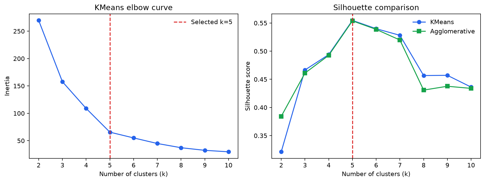
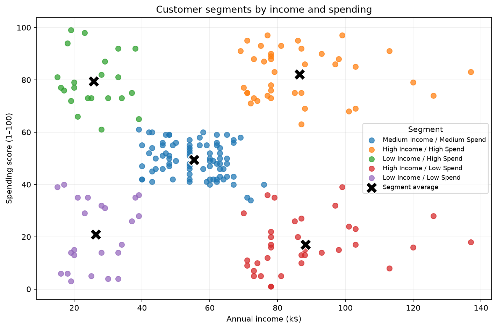

# Customer Segmentation Analysis

**Dataset:** `C:\Users\Himanshi Verma\Downloads\Mall_Customers.csv`  
**Customers analysed:** 200  
**Selected method:** KMeans, k=5 (silhouette 0.555)  
**Clustering features:** annual income and spending score, median-imputed and standardized.

## Method and cluster selection

CustomerID was excluded because it is an identifier. Age and gender were held out of clustering and used to describe the resulting groups. KMeans and Ward-linkage agglomerative clustering were compared for k=2 to 10 using silhouette score; KMeans inertia was also reviewed with the elbow curve. The selected k is the KMeans option with the highest silhouette in that range.

The best agglomerative result in the same range was k=5 with silhouette 0.554. Silhouette is a separation diagnostic, not proof that customer behavior has discrete natural boundaries.

## Segment profiles and business actions

| Segment                      | Customers | Share | Avg. age | Avg. income (k$) | Avg. spend score | Female share | Suggested action                                                               |
| ---------------------------- | --------: | ----: | -------: | ---------------: | ---------------: | -----------: | ------------------------------------------------------------------------------ |
| Medium Income / Medium Spend |        81 | 40.5% |     42.7 |             55.3 |             49.5 |        59.3% | Use personalized cross-sells and measure response before scaling.              |
| High Income / High Spend     |        39 | 19.5% |     32.7 |             86.5 |             82.1 |        53.8% | Reward loyalty; test premium and early-access offers.                          |
| Low Income / High Spend      |        22 | 11.0% |     25.3 |             25.7 |             79.4 |        59.1% | Encourage repeat visits with value bundles; monitor offer economics.           |
| High Income / Low Spend      |        35 | 17.5% |     41.1 |             88.2 |             17.1 |        45.7% | Test relevant discovery and premium-category recommendations.                  |
| Low Income / Low Spend       |        23 | 11.5% |     45.2 |             26.3 |             20.9 |        60.9% | Use low-cost re-engagement and entry-price offers; avoid expensive incentives. |

## Data quality and caveats

Missing values in clustering inputs before imputation: annual income 0; spending score 0. The preprocessing pipeline uses median imputation followed by standard scaling. Segment names describe low, middle, and high bands of cluster-average income and spending across the selected clusters.

Spending Score is a dataset-provided score, not observed transaction history, so these results support targeting hypotheses rather than causal claims. Validate offers with campaign tests and refresh segments as purchasing data changes. Demographic summaries are descriptive and should not be used as a substitute for testing customer response.

## Files

- `customers_with_segments.csv`: original customer records plus cluster and readable segment labels.
- `segment_profiles.csv`: cluster size and average demographic/spending profile.
- `cluster_metrics.csv`: KMeans and agglomerative silhouette scores; KMeans inertia.
